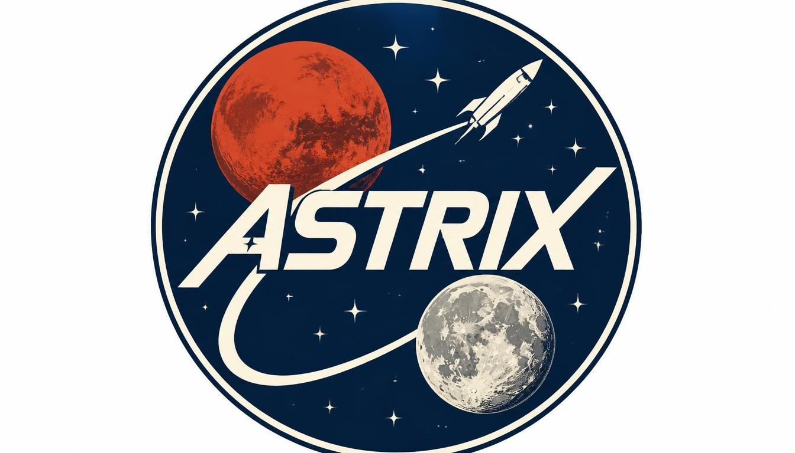

# ASTRIX

 
Welcome to Astrix! This is BK2s submission for the Nasa Space Apps 2026
## How Astrix works
Astrix is a dashboard system which presents analog locations to a user via data processing. 
How Astrix processes the data:
1) Calls NASAs APIs
2) Processes it (cleaning,comparing it with other arrays)
3) Filters it
4) Shows all the data in the dashboard
## Credits: The BK2s Team
**Alma Tolosa**
 
*@TolosaAlma*
 
 
**Facundo Roda**
 
*@AxelRoda202*
 
 
**Franca Polack**
 
*@francapolack*
 
 
**Matias Gil**
 
*@escudero819*
 
 
**Romina Arias**
*@AriasRominaFlorencia*
 
 
**Sofia Grillo**
 
*@sofigrillo16-lec*
